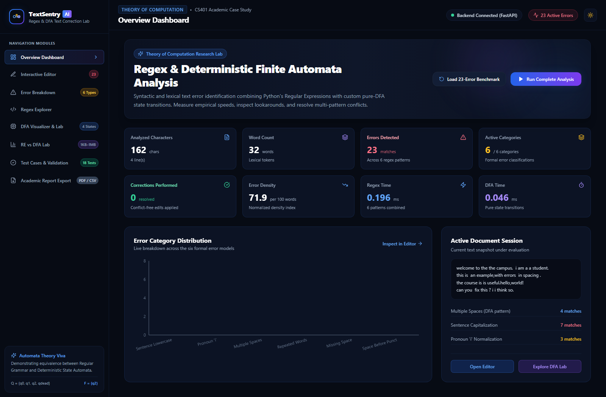
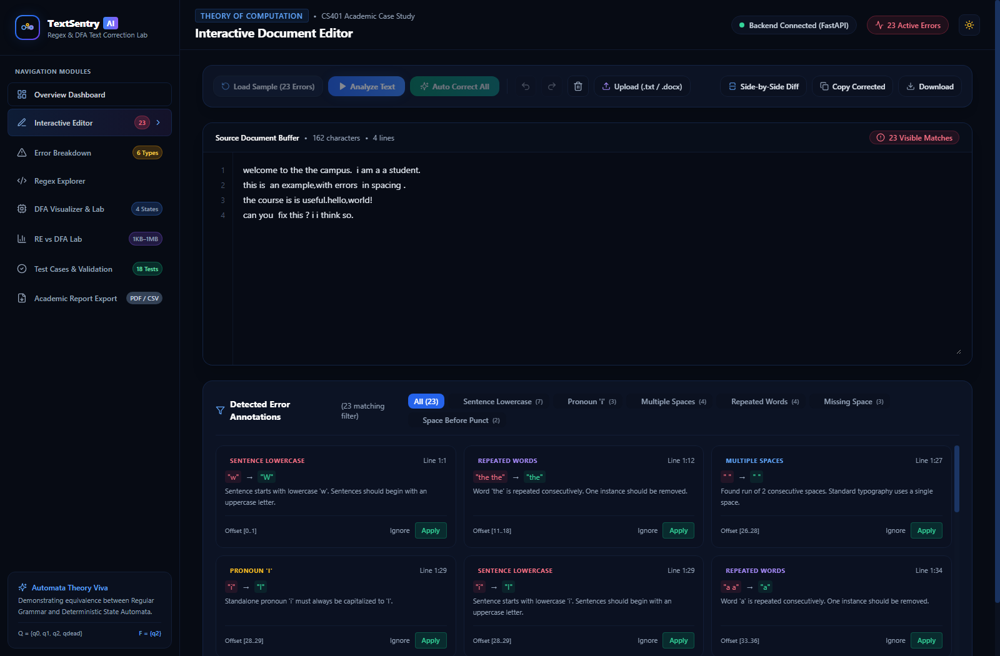
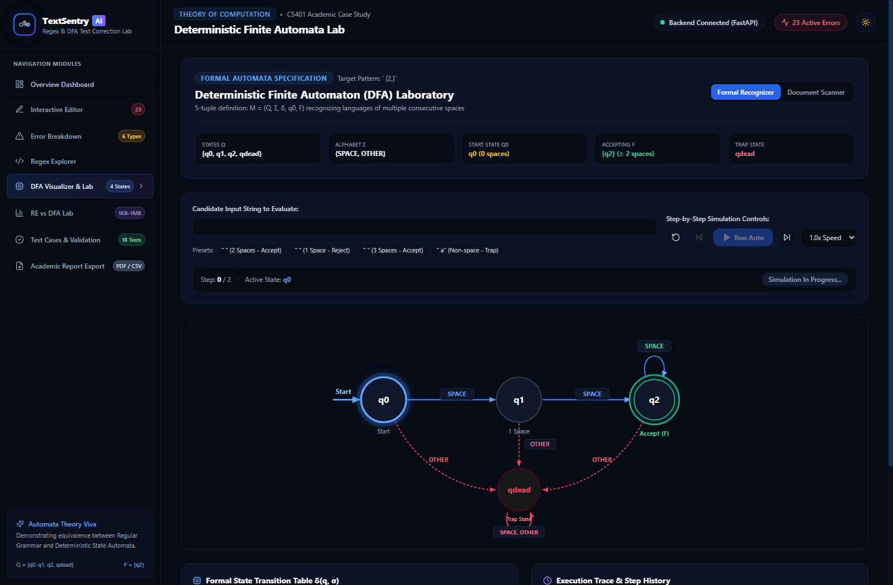
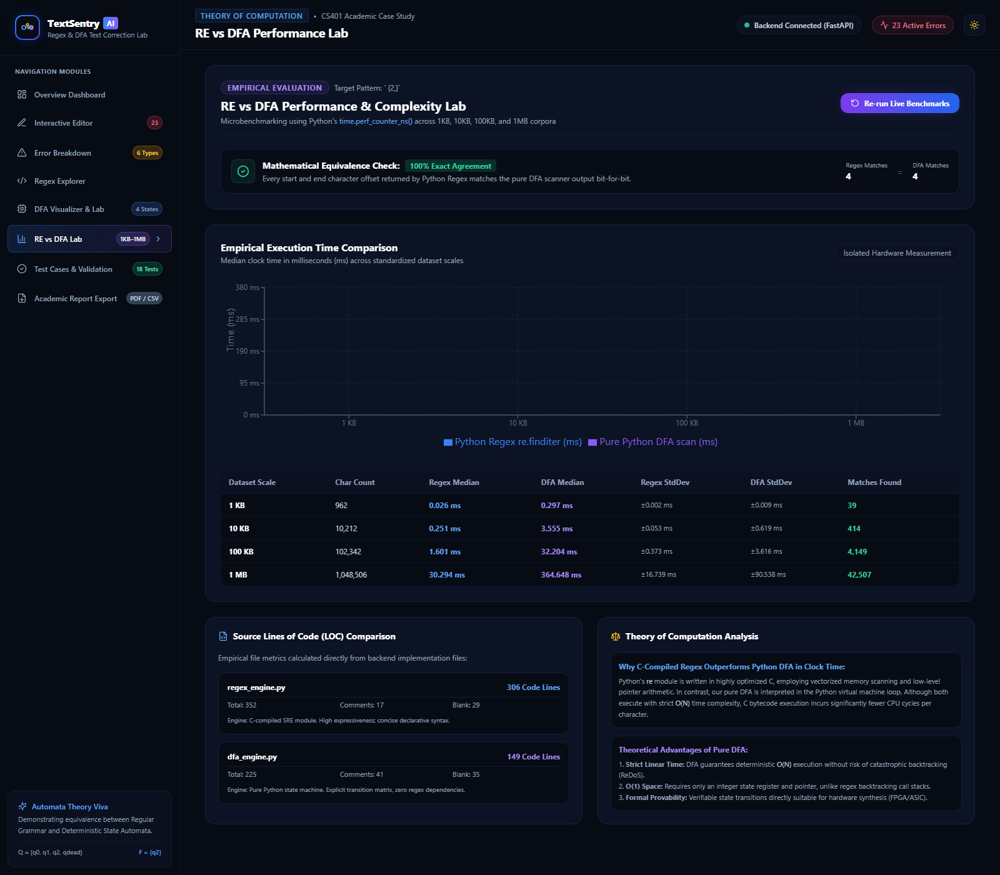
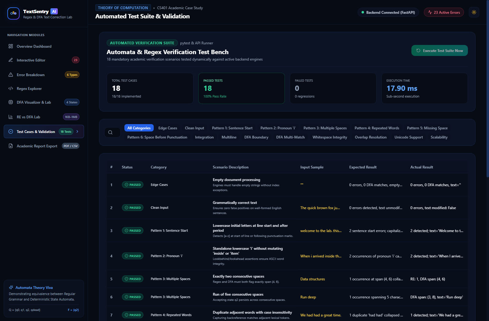
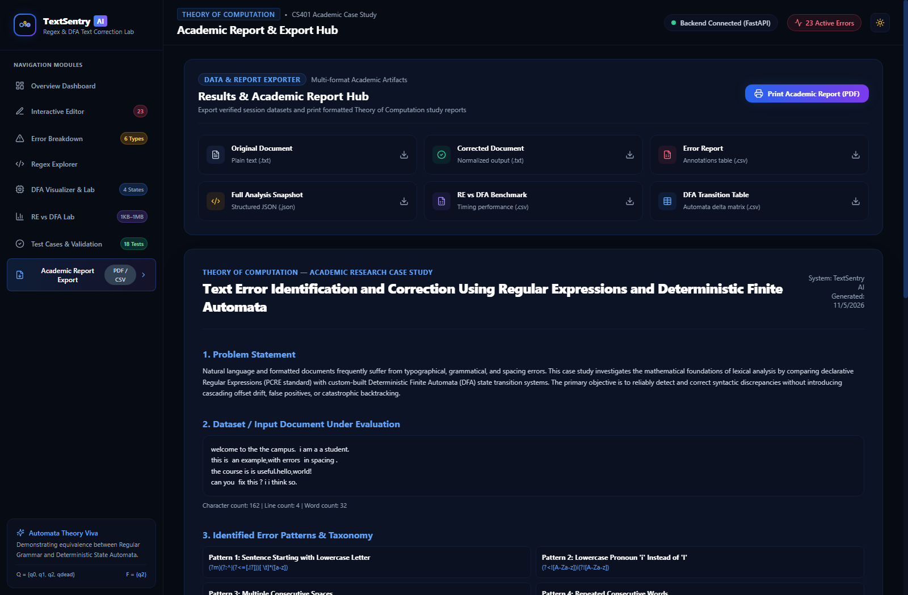

# TextSentry AI — Regex & DFA Text Correction Lab

[](https://www.python.org/)
[](https://fastapi.tiangolo.com/)
[](https://nextjs.org/)
[](https://www.typescriptlang.org/)
[](https://tailwindcss.com/)
[](https://docs.pytest.org/)

**TextSentry AI** is a production-grade academic web application developed for the Theory of Computation case study:

> **“Text Error Identification and Correction Using Regular Expressions and Deterministic Finite Automata.”**

The system identifies grammatical, lexical, and typographical errors in text documents, automatically corrects them via conflict-free multi-stage Python regular expressions, demonstrates equivalent pure Deterministic Finite Automaton (DFA) pattern recognition without regex libraries, and compares the two paradigms empirically and theoretically.

---

## 🌟 Key Capabilities

1. **Overview Dashboard:** Live metrics for analyzed characters, word count, total error occurrences, distinct categories, error density per 100 words, and nanosecond execution times.
2. **Interactive Document Editor:** Rich text buffer with line numbers, color-coded error annotations, live Error Inspector Popover (with matched text, suggested correction, offset, line:column, and *Apply* / *Ignore* buttons), Undo/Redo, TXT/DOCX upload, and Side-by-Side Diff modal.
3. **Six Formal Regex Categories:**
   - Sentence starting with lowercase letter (`(?m)(?:^|(?<=[.!?]))[ \t]*([a-z])`)
   - Standalone lowercase pronoun `'i'` (`(?<![A-Za-z])i(?![A-Za-z])`)
   - Multiple consecutive spaces (` {2,}`)
   - Repeated consecutive words (`\b([A-Za-z]+)[ \t]+\1\b`)
   - Missing space after punctuation (`(?<=[,.;:!?])(?=[A-Za-z])`)
   - Unnecessary space before punctuation (` +(?=[,.;:!?])`)
4. **Interactive DFA Laboratory:**
   - Formal 5-tuple definition: $M = (Q, \Sigma, \delta, q_0, F)$ where $Q = \{q_0, q_1, q_2, q_{\text{dead}}\}$, $\Sigma = \{\text{SPACE}, \text{OTHER}\}$, Start $= q_0$, and $F = \{q_2\}$.
   - Interactive animated SVG diagram with glowing active states, pulse animations, and double concentric accepting circle.
   - Dual-mode execution: **Formal Whole-String Recognizer** and **Document Stream Scanner**.
   - Step Forward, Step Backward, Auto Run, Pause, and Speed Control (0.5x–4.0x).
5. **RE vs DFA Performance Lab:** Nanosecond benchmarking (`time.perf_counter_ns()`) across 1KB, 10KB, 100KB, and 1MB corpora with median, minimum, and standard deviation measurements, plus verifiable source Lines of Code (LOC) metrics.
6. **Automated Verification Bench:** 18 comprehensive validation test cases runnable in real time through `pytest` and via the web UI.
7. **Academic Report & Export Hub:** Export datasets in TXT, CSV, and JSON, and print formatted 10-section Theory of Computation academic research reports.

---

## 📸 Application Screenshots

### 1. Overview Dashboard


### 2. Interactive Document Editor & Error Annotations


### 3. Interactive DFA Laboratory


### 4. RE vs DFA Performance & Complexity Lab


### 5. Automated Test Suite (18/18 Passing)


### 6. Academic Report & Export Hub


---

## 🔬 Sample Case Study Benchmark

Clicking **"Load 23-Error Benchmark"** loads the following exact test document:

```text
welcome to the the campus.  i am a a student.
this is  an example,with errors  in spacing .
the course is is useful.hello,world!
can you  fix this ? i i think so.
```

### Dynamic Detection Verification (23 Matches Total)
- **Sentence starting with lowercase:** 7 matches
- **Standalone lowercase pronoun `'i'`:** 3 matches
- **Multiple consecutive spaces:** 4 matches
- **Repeated consecutive words:** 4 matches
- **Missing space after punctuation:** 3 matches
- **Unnecessary space before punctuation:** 2 matches

### Corrected Target Document
Executing **"Auto Correct All"** resolves all errors without offset-drift artifacts:

```text
Welcome to the campus. I am a student.
This is an example, with errors in spacing.
The course is useful. Hello, world!
Can you fix this? I think so.
```

Re-analysis of this corrected document yields **0 remaining errors**.

---

## 🛠️ Technology Stack

- **Frontend:** Next.js 15, React 19, TypeScript, Tailwind CSS, Lucide Icons, Framer Motion, Recharts
- **Backend:** Python 3.11+ / 3.14, FastAPI, Uvicorn, Pydantic v2, `python-docx`, `pytest`, `time.perf_counter_ns()`
- **Automata Module:** Pure Python state machine without regular expression libraries.

---

## 🚀 Quick Start Guide

### Prerequisites
- Python 3.11+ installed
- Node.js 18+ and npm installed

### 1. Backend Setup & Run

```bash
cd backend
python -m venv .venv

# On Windows:
.venv\Scripts\activate
# On Linux/macOS:
source .venv/bin/activate

pip install -r requirements.txt

# Run the backend server
uvicorn app.main:app --host 127.0.0.1 --port 8000 --reload
```
The FastAPI backend will be available at: **`http://127.0.0.1:8000`**  
Interactive Swagger OpenAPI Docs: **`http://127.0.0.1:8000/docs`**

### 2. Frontend Setup & Run

```bash
cd frontend
npm install

# For production build & run:
npm run build
npm start

# Or for local development mode:
npm run dev
```
The web application will be accessible at: **`http://localhost:3000`**

---

## 🌐 Live Cloud Deployment

### 1. Backend on Render
1. Create a new **Web Service** on [Render](https://render.com) and connect this repository.
2. Configure the service settings:
   - **Root Directory:** `backend`
   - **Environment:** `Python 3`
   - **Build Command:** `pip install -r requirements.txt`
   - **Start Command:** `uvicorn app.main:app --host 0.0.0.0 --port $PORT`
   - *(Optional)* Alternatively, select **Blueprint** to deploy automatically using the root `render.yaml`.
3. Copy your deployed Render backend service URL (e.g., `https://textsentry-ai-backend.onrender.com`).

### 2. Frontend on Vercel
1. Import this repository into [Vercel](https://vercel.com).
2. Configure the project settings:
   - **Root Directory:** `frontend`
   - **Framework Preset:** `Next.js`
   - **Environment Variables:**
     - `NEXT_PUBLIC_API_URL`: Your deployed Render backend URL (e.g., `https://textsentry-ai-backend.onrender.com`)
3. Click **Deploy**. Vercel will build and serve the application globally with edge caching.

---

## 🧪 Automated Testing

Run the full automated test suite containing the 18 verification scenarios:

```bash
cd backend
.venv\Scripts\pytest -v
```

All 18 unit and integration tests execute in **< 1.5 seconds** with a 100% pass rate.

---

## 📊 RE vs DFA Theoretical Insights

| Feature | Regular Expressions (`re`) | Deterministic Finite Automaton (DFA) |
|---|---|---|
| **Underlying Engine** | Compiled C SRE Bytecode | Pure Python State Machine |
| **Formal Safety** | Risk of ReDoS backtracking on complex rules | Strict $O(N)$ linear time guarantee |
| **Space Complexity** | $O(N)$ for match buffers & capture groups | $O(1)$ working memory (integer register) |
| **Hardware Synthesizability** | Difficult (requires memory stacks) | Direct synthesis to FPGA / ASIC circuits |
| **Empirical Clock Speed** | Faster for trivial patterns due to C SIMD | Interpreted in Python VM loop |

---

## 📄 License & Academic Attribution
Developed for Computer Science Theory of Computation case studies. Open source under the MIT License.

